<p align="center">
  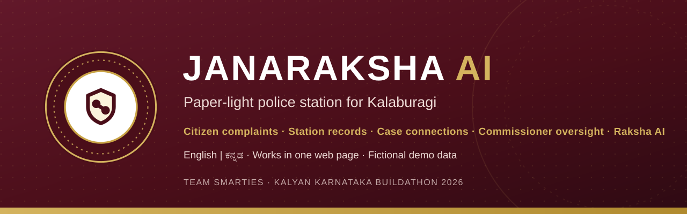
</p>

<p align="center">
  <a href="https://github.com/Shivashankar018/Janaraksha-Ai/actions/workflows/ci.yml"></a>
  <a href="LICENSE"></a>
  
  
  
  
  
</p>

<p align="center">
  <b>One web page that connects citizens, police stations and the Commissioner's office:</b><br />
  online complaints, structured station records, explainable case connections, escalation and the <b>Raksha AI</b> case assistant.
</p>

<p align="center">
  <a href="#quick-start">Quick start</a> ·
  <a href="docs/demo-guide.md">Demo guide</a> ·
  <a href="docs/features.md">Features</a> ·
  <a href="docs/architecture.md">Architecture</a> ·
  <a href="docs/README.md">All documentation</a>
</p>

---

> [!IMPORTANT]
> JanaRaksha AI is a **working prototype** built by Team Smarties for the **Kalyan Karnataka Buildathon 2026**. Every person, complaint, phone number, ID number and record in it is **fictional**. It is **not** an official product of the Karnataka State Police or the Kalaburagi City Police, and it has **no connection** to CCTNS or any other government system.

## Table of contents

- [The problem](#the-problem)
- [Our solution](#our-solution)
- [Key features](#key-features)
- [Screenshots](#screenshots)
- [How it works](#how-it-works)
- [Technology](#technology)
- [Quick start](#quick-start)
- [Demo accounts](#demo-accounts)
- [Project structure](#project-structure)
- [What is built, what is demo-only, what is planned](#what-is-built-what-is-demo-only-what-is-planned)
- [Documentation](#documentation)
- [Contributing](#contributing)
- [Team](#team)
- [License](#license)

## The problem

Police stations hold a lot of information, but it is hard to find and use:

| Challenge | What happens today |
| --- | --- |
| **Manual file search** | Finding one detail in older files can mean browsing many physical registers. |
| **Fragmented information** | Names, phone numbers, vehicles, dates and places sit in different documents, so links between cases are missed. |
| **Repeated data entry** | New information is written in different formats, so it does not become searchable. |
| **Citizens wait in the dark** | A citizen who files a complaint has no simple way to see what the police did next. |
| **Limited oversight** | Senior officers cannot easily see which complaints are stuck, at which station, and for how long. |

## Our solution

JanaRaksha AI puts the whole complaint journey in **one officer-reviewed workflow**:

1. **Citizens** file a complaint online with a mobile number and OTP, then track it with a complaint code such as `CMP/2026/1001`.
2. **Station officers** verify each complaint, type new records in guided fields, turn paper files into structured data with OCR, and see links to older cases.
3. **The Commissioner** sees every station in one dashboard, with escalations for work not done in time, and sends instructions and remarks to stations.
4. **Raksha AI** answers "what is this case, what happened, and where is it now?" for any complaint code.

The platform **supports** authorised procedures. It does not replace them: officers verify every record, and nothing becomes trusted without a human decision.

## Key features

<table>
<tr>
<td width="33%" valign="top">

### Citizen portal
- Mobile number and OTP login (demo OTP shown on screen)
- Six-step complaint form: details, ID proof, address, incident, police station, review
- Aadhaar check-digit and PAN format checks; the full ID number is masked
- Photo and evidence upload
- Printable and downloadable acknowledgment slip
- "My complaints": status, FIR number, police messages and replies

</td>
<td width="33%" valign="top">

### Police phase (station)
- Station dashboard with live counts for the officer's station
- **Direct Entry of Data**: guided fields, masked Aadhaar or PAN, rule checks, law-section suggestions, e-signatures
- **Document Scanner**: upload or photograph a paper complaint; OCR fills the Direct Entry form
- **Case Connection**: links by person, phone, vehicle, IMEI, place or accused name, with the reason shown
- Verification checklist, FIR number on registration, investigation stages and timeline
- Role-based permissions and a full audit trail

</td>
<td width="33%" valign="top">

### Commissioner phase
- All-station dashboard: total, escalated, pending, verified and resolved complaints
- Station-wise table for all 37 Kalaburagi police stations in the demo data
- **Escalations**: online complaints and station tasks not acted on within the time limit
- Send instructions, give work to another officer, read station replies
- Progress tracking: Filed › Verified › Under investigation › Action taken › Resolved, with remarks

</td>
</tr>
</table>

**Raksha AI case assistant**: type a complaint code (for example `CMP/2026/1003`) and get the case details, what happened, the current stage, the FIR number, a live timeline with the handling officer and the time of the last update, and the next step. A code that does not exist gives "This case does not exist". See [how Raksha works](docs/features.md#raksha-ai-case-assistant).

**Also built in:** English and Kannada interface, light and dark mode, phone-friendly layout, notifications, and live updates between browser tabs.

## Screenshots

| Commissioner dashboard | Escalations |
| --- | --- |
| 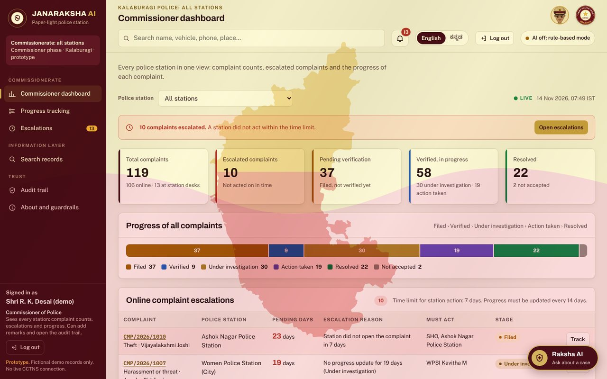 | 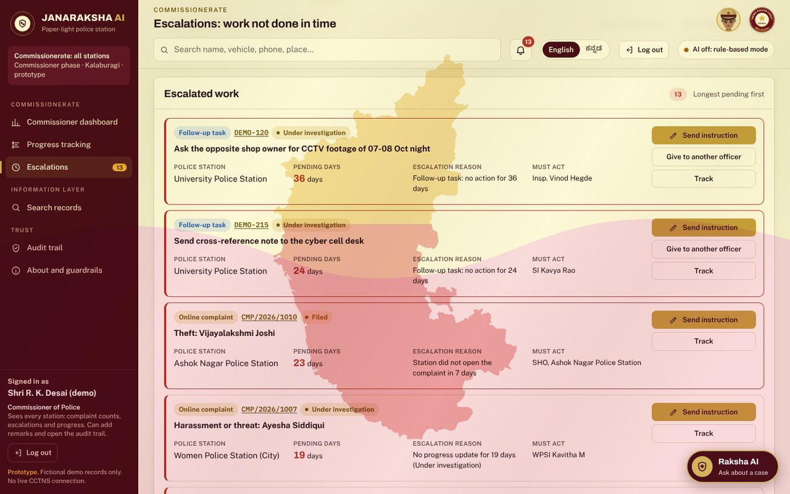 |
| **Police station dashboard** | **Direct Entry of Data** |
| 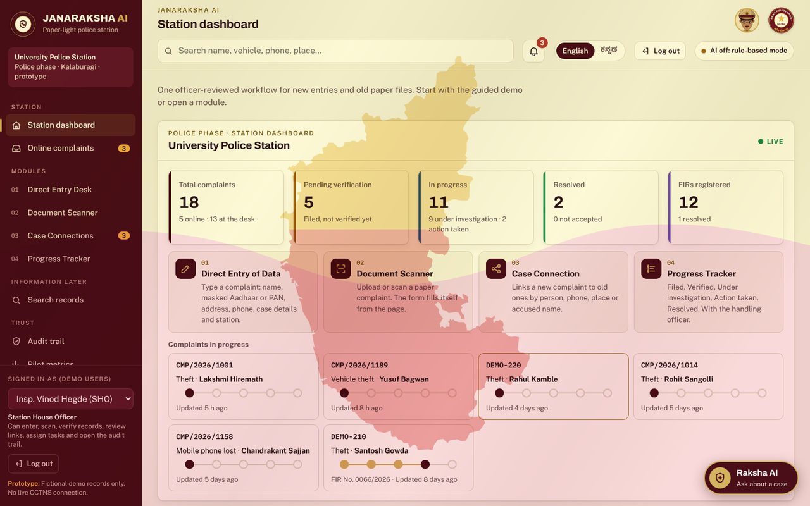 | 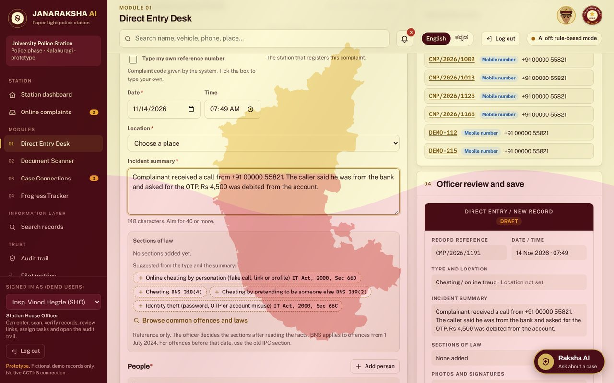 |
| **Document Scanner** | **Raksha AI** |
| 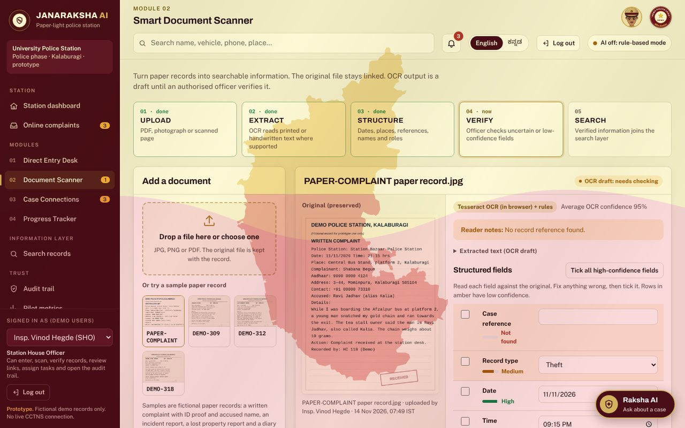 | 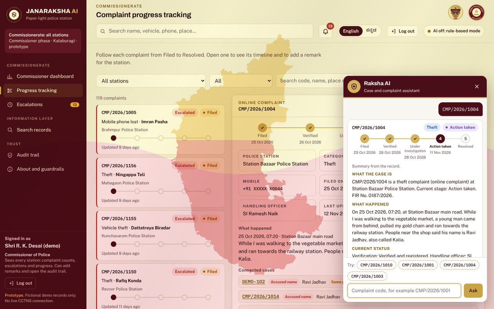 |
| **Citizen complaint review** | **Kannada interface** |
| 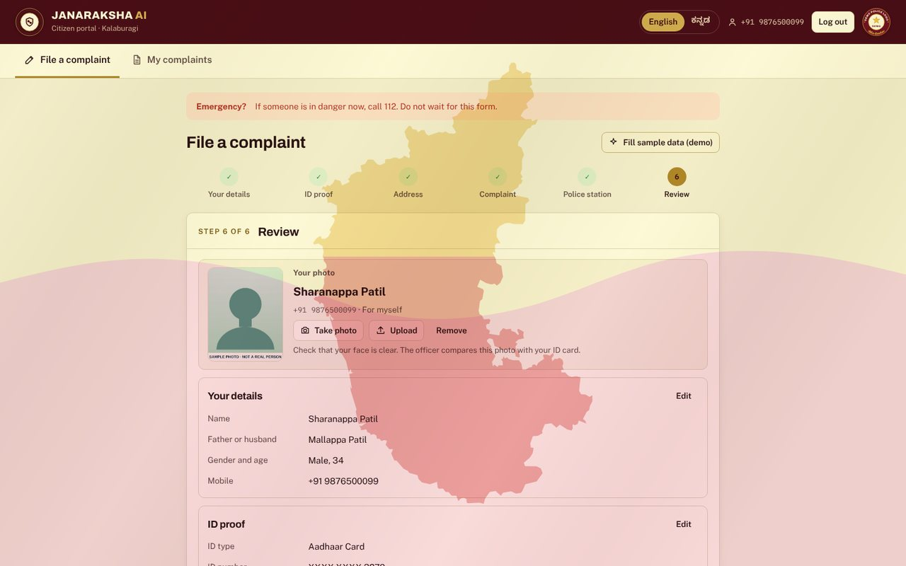 | 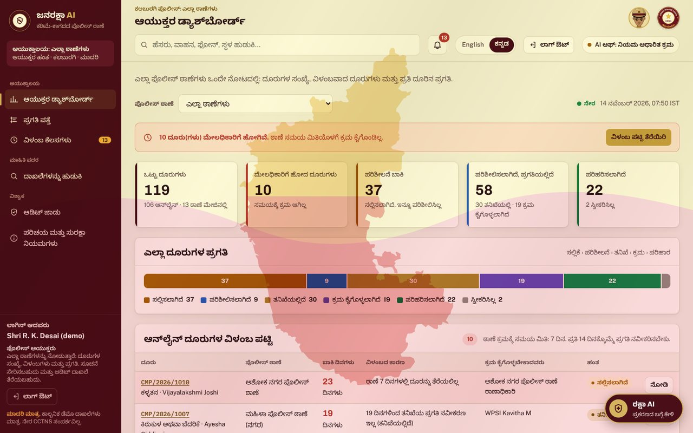 |

<p align="center">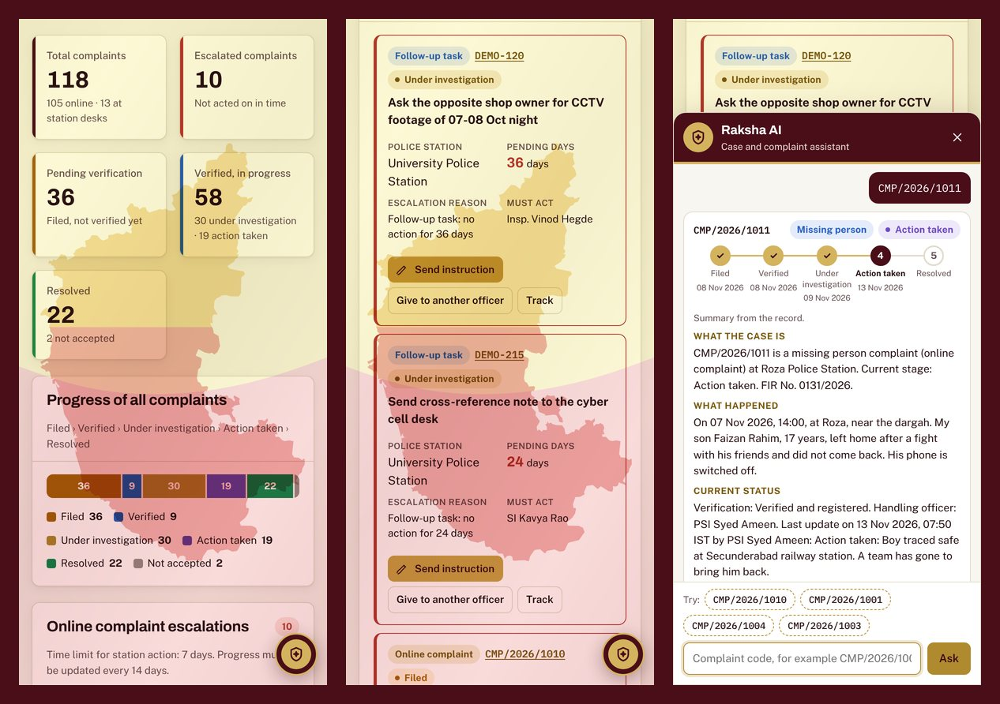</p>

More screens: [docs/screenshots.md](docs/screenshots.md).

## How it works

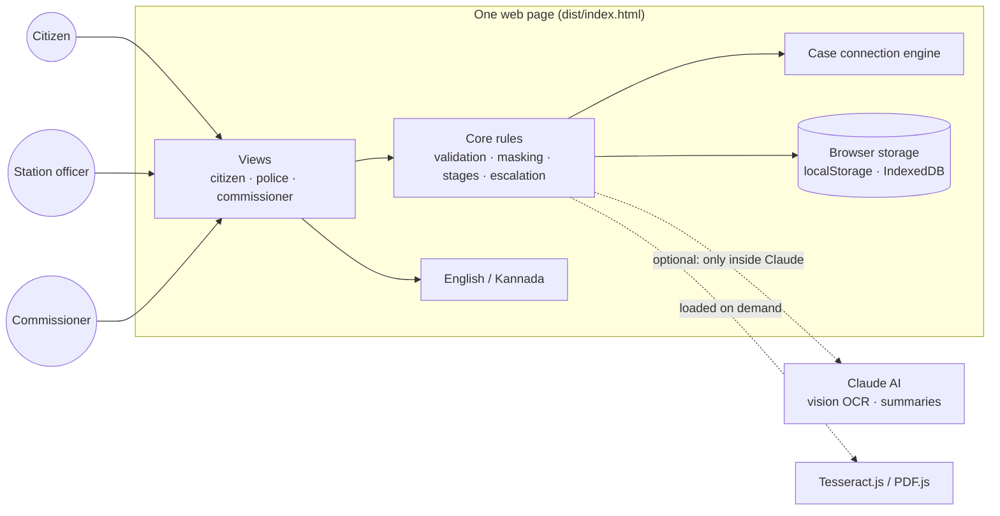

- The app is **one self-contained HTML file**. There is no server and no database: demo data lives in each viewer's browser.
- Two tabs in the same browser act as two users. A complaint filed in one tab appears in the officer's tab at once.
- AI features run **only** when the page is opened inside Claude and AI is allowed. Everywhere else the app uses its built-in rule checks and in-browser OCR, and says so on screen.

Read the full [architecture](docs/architecture.md) and the [user workflows](docs/user-workflows.md).

## Technology

| Layer | In this prototype | Proposed for a pilot (not built) |
| --- | --- | --- |
| Front end | Plain HTML, CSS and JavaScript in one page | React / Next.js officer workspace |
| Back end | None (rules run in the browser) | Python FastAPI for rules, roles and workflow |
| Data | Browser `localStorage` and `IndexedDB` | PostgreSQL with relationship indexing |
| OCR | Tesseract.js (in the browser), PDF.js; Claude vision when run inside Claude | Tesseract or an approved document-AI service |
| AI | Claude, only when the page runs inside Claude | An approved language model |
| Security | Demo role checks, masking, audit log in the browser | Server-side auth, encryption, central audit logging |
| Build and test | Python 3 build script, Playwright end-to-end tests, GitHub Actions | |

## Quick start

You need **Python 3.9 or later**. Nothing else is required to build or run the app.

```bash
git clone https://github.com/Shivashankar018/Janaraksha-Ai.git
cd Janaraksha-Ai
python3 scripts/build.py          # writes dist/index.html
```

Then open `dist/index.html` in Chrome, Edge or Firefox, or serve it:

```bash
python3 -m http.server 8000 --directory dist
# open http://localhost:8000
```

Run the end-to-end tests (optional):

```bash
pip install -r tests/requirements.txt
python3 -m playwright install chromium
python3 -m pytest
```

With `make`: `make build`, `make serve`, `make test`. Full details: [installation guide](docs/installation.md).

> [!NOTE]
> No environment variables or API keys are needed. The app has no server and makes no calls to private services. Fonts load from Google Fonts, and the OCR libraries load from public CDNs only when a user scans a new document.

## Demo accounts

All admin passwords are `demo1234`. These are demo accounts only.

| Phase | ID | Name | Role |
| --- | --- | --- | --- |
| Commissioner | `KLB-CP-01` | Shri R. K. Desai (demo) | Commissioner of Police |
| Police | `KLB-SHO-01` | Insp. Vinod Hegde | Station House Officer |
| Police | `KLB-SI-02` | SI Kavya Rao | Sub-Inspector |
| Police | `KLB-HC-03` | HC Imran Shaikh | Head Constable (Writer) |
| Police | `KLB-CLK-04` | Lata Mane | Records Clerk |

**Citizen:** enter any 10-digit mobile number. The OTP appears on screen as a demo SMS. The number `9000000011` has an existing complaint (`CMP/2026/1001`).

A five-minute walkthrough for judges and reviewers is in the [demo guide](docs/demo-guide.md).

## Project structure

```text
Janaraksha-Ai/
├── src/                     # application source (plain HTML, CSS, JavaScript)
│   ├── index.html           # page template; the build inlines styles and scripts here
│   ├── styles/main.css      # theme, layout, dark mode, print styles
│   ├── assets/              # embedded sample documents and the login photo
│   └── js/
│       ├── data/            # fictional demo users, stations, records and complaints
│       ├── core/            # helpers, state, storage, validation, OCR and AI hooks, link engine
│       ├── i18n/            # translation engine and Kannada dictionaries
│       ├── ui/              # brand drawings and the station views
│       ├── features/        # portal, progress, commissioner, escalation, Raksha, laws, acknowledgment
│       └── app.js           # rendering, routing, actions, start-up (loads last)
├── scripts/                 # build script and the sample-document generator
├── tests/                   # Playwright end-to-end tests (pytest)
├── docs/                    # architecture, features, workflows, guides, images
├── .github/                 # CI workflow, Pages workflow, issue and PR templates
└── dist/                    # build output (not committed)
```

The [architecture guide](docs/architecture.md#source-modules) explains each module and why the load order matters.

## What is built, what is demo-only, what is planned

We keep this list honest so that reviewers know exactly what they are looking at.

| Area | Status | Notes |
| --- | --- | --- |
| Citizen complaint filing, tracking, acknowledgment | ✅ Built | Works end to end in the browser |
| Police verification, Direct Entry, Scanner, Case Connection, progress stages | ✅ Built | Rule-based; officer decides every step |
| Commissioner dashboard, escalations, instructions, remarks | ✅ Built | Escalations are visible only to the Commissioner |
| Raksha AI case lookup | ✅ Built | Rule-based summary everywhere; AI-written summary only inside Claude |
| English and Kannada | ✅ Built | Records stay in the language they were written in |
| OTP login | 🟡 Demo only | The OTP is shown on screen; no SMS is sent |
| Officer login | 🟡 Demo only | Fixed demo IDs and one demo password; no real authentication |
| Data storage | 🟡 Demo only | Each browser keeps its own copy; no shared server |
| Multi-user notifications | 🟡 Demo only | Between tabs of one browser, not between devices |
| Demo clock for escalations | 🟡 Demo only | Moves time forward to show escalations without waiting |
| Server back end, central database, real authentication, SMS | ⏳ Planned | See the [roadmap](docs/roadmap.md) |
| CCTNS or any government-system integration | ⏳ Planned | Only with government approval |

Details for every feature: [docs/features.md](docs/features.md).

## Documentation

| Guide | What it covers |
| --- | --- |
| [Installation](docs/installation.md) | Build, run, test, deploy, troubleshooting |
| [Demo guide](docs/demo-guide.md) | Demo accounts, sample codes and a five-minute walkthrough |
| [Features](docs/features.md) | Every feature by role, with its status |
| [User workflows](docs/user-workflows.md) | Complaint journey, verification, stages, escalation, Raksha |
| [Architecture](docs/architecture.md) | Modules, data flow, storage, AI and OCR, build pipeline |
| [Data model](docs/data-model.md) | Complaints, records, tasks, audit entries, codes and FIR numbers |
| [Security and privacy](docs/security-and-privacy.md) | Prototype boundary, masking, what a pilot needs |
| [Localization](docs/localization.md) | How English and Kannada work and how to add text |
| [Roadmap](docs/roadmap.md) | Planned work, clearly marked as not built |

## Contributing

Contributions are welcome. Read [CONTRIBUTING.md](CONTRIBUTING.md) for the workflow, code style and the test checklist, and follow our [Code of Conduct](CODE_OF_CONDUCT.md). To report a security problem, see [SECURITY.md](SECURITY.md).

## Team

**Team Smarties**, Kalyan Karnataka Buildathon 2026

- **Team leader:** Shaik Mohammad Umar Farooq
- **Members:** Sameer Ahmed, Mohammad Osman Ghori, Asif Ahmed

## License

The source code is released under the [MIT License](LICENSE). The login-page photo is not covered by this license; see [docs/assets/README.md](docs/assets/README.md).

<p align="center"><br /><sub>JanaRaksha AI · ಜನರಕ್ಷಾ AI</sub></p>
