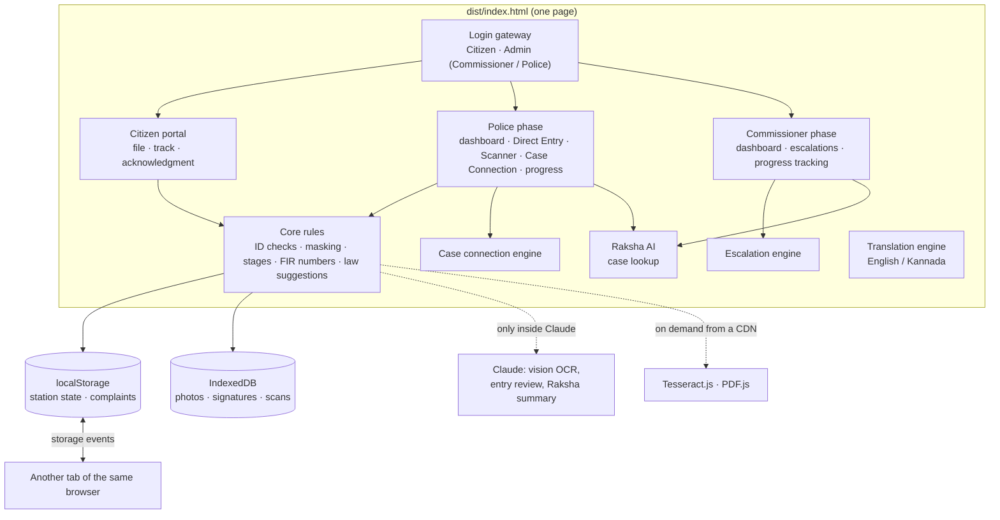
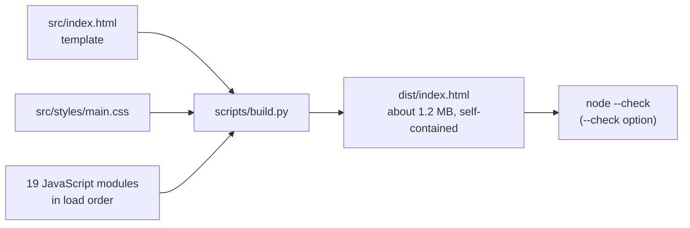

# Architecture

JanaRaksha AI is a **single-page web app with no server**. The build joins the stylesheet and the JavaScript modules into one HTML file (`dist/index.html`). Everything, including the demo data, the rule checks and the case connection engine, runs in the browser.

This design was chosen for the buildathon: the prototype opens anywhere with no install, and judges can try every role on one machine. A real pilot needs a server, a database and real authentication. See [What a pilot changes](#what-a-pilot-changes).

## Contents

- [System overview](#system-overview)
- [Source modules](#source-modules)
- [Rendering and events](#rendering-and-events)
- [State and storage](#state-and-storage)
- [Roles and phases](#roles-and-phases)
- [Case connection engine](#case-connection-engine)
- [Escalation engine](#escalation-engine)
- [AI and OCR](#ai-and-ocr)
- [Localization](#localization)
- [Build pipeline](#build-pipeline)
- [Testing and CI](#testing-and-ci)
- [What a pilot changes](#what-a-pilot-changes)

## System overview

## Source modules

The modules are plain scripts that share one global scope. The build joins them **in a fixed order**, set in [`scripts/build.py`](../scripts/build.py). A module may only run code at load time that uses names from modules above it. After the page loads, any function may call any other function. `app.js` starts the app, so it is always last.

| Order | File | Responsibility |
| --- | --- | --- |
| 1 | `src/assets/sample-documents.js` | Fictional scanned papers (images and OCR text) for the Document Scanner demo |
| 2 | `src/js/data/seed-state.js` | Demo users, roles and permissions, record types, fictional station records, tasks and audit entries |
| 3 | `src/js/core/core.js` | Helpers, IST date and time, state load and save, IndexedDB media store, validation and masking, OCR text structuring, AI hooks, link engine, metrics |
| 4 | `src/js/i18n/i18n.js` | Translation engine (`trStr`, `trDOM`) |
| 5 | `src/js/i18n/kn-dictionary.js` | Kannada text for the officer workspace |
| 6 | `src/js/i18n/kn-dictionary-portal.js` | Kannada text for the login, citizen portal, Commissioner phase and Raksha |
| 7 | `src/js/features/laws.js` | Common offences and law sections (BNS, with the old IPC section for reference), suggestion and search |
| 8 | `src/assets/gateway-photo.js` | Login page photo |
| 9 | `src/js/ui/brand.js` | Original drawings: JanaRaksha badge, demo logo, Karnataka map and flag watermarks, officer avatars |
| 10 | `src/js/ui/views.js` | Station shell (sidebar, top bar), page list, station pages, audit, metrics and about pages |
| 11 | `src/js/features/portal.js` | Login gateway, citizen portal, complaint store, online complaints inbox and verification, notifications |
| 12 | `src/js/data/seed-complaints.js` | Fictional online complaints `CMP/2026/1001` to `1016` |
| 13 | `src/js/data/seed-complaints-stations.js` | Fictional complaints for every station, `CMP/2026/1101` onward |
| 14 | `src/js/features/progress.js` | Complaint codes, FIR numbers, the five stages, timelines, connected cases |
| 15 | `src/js/features/commissioner.js` | Commissioner dashboard and progress tracking |
| 16 | `src/js/features/escalation.js` | Escalation to the Commissioner, instructions and replies |
| 17 | `src/js/features/raksha.js` | Raksha AI case assistant |
| 18 | `src/js/features/acknowledgment.js` | Printable acknowledgment slip for citizens |
| 19 | `src/js/app.js` | Rendering, routing, actions, event wiring and start-up |

## Rendering and events

- **Render:** `render()` in `app.js` builds HTML strings and paints three regions: `#app` (gateway, citizen portal or the officer shell), `#overlay` (modals, drawers, the notification panel) and `#raksha` (the Raksha panel). Focus and scroll position are kept across repaints.
- **Routing:** the URL hash selects the page (`#entry`, `#escalations`, ...). `route()` checks that the signed-in phase may open the page and falls back to the phase's home page.
- **Events:** one delegated listener per event type. Elements declare what they do with attributes:
  - `data-act="name"` calls `ACT.name(el, event)` on click
  - `data-bind="name"` calls `BIND.name(el)` on `change`, or on `input` for names in the `LIVE` set
  - `data-form="name"` calls `FORMS.name(form)` on submit
- Each feature module defines its own handler object (for example `CPACT`, `EACT`, `RKACT`). `app.js` merges them into `ACT`, `BIND` and `FORMS`.

## State and storage

| Store | Key | Content |
| --- | --- | --- |
| `localStorage` | `janaraksha-ai-demo-v5` | Station state `S`: records, scanned documents, tasks, notes, links, audit log, metrics, escalation settings and notifications, the Direct Entry draft, the language |
| `localStorage` | `janaraksha-complaints-v2` | Online complaints `C` (shared by every tab of the browser) |
| `localStorage` | `janaraksha-complaints-v2-seed` | Version of the demo complaints already added to this browser |
| `IndexedDB` | `janaraksha-media` | Photos, signatures, thumb impressions and scanned pages |
| memory | `SESSION` | The signed-in user. A reload always opens the login gateway |

- **Seeding:** on first load the app writes the fictional demo data. When a newer version adds demo complaints, they are added once to a browser that already has data, without changing what the user entered.
- **Live updates:** when one tab saves, the browser fires a `storage` event in the other tabs, which re-read the data and show a notification. This is how "citizen files, officer is notified" works in the demo.
- **Reset:** *About and guardrails › Reset demo data* restores the demo data in that browser.
- **Demo clock:** `nowMs()` adds the Commissioner's demo-clock offset (days) to the real time, so escalations can be shown without waiting.

See the [data model](data-model.md) for the shape of each object.

## Roles and phases

| Phase | Roles | Home page |
| --- | --- | --- |
| Citizen | Anyone with a mobile number (demo OTP) | File a complaint or My complaints |
| Police | SHO, SI, Head Constable, Records Clerk | Station dashboard |
| Commissioner | Commissioner of Police | Commissioner dashboard |

Permissions are in `PERMS` in `seed-state.js`: only SHO and SI may verify records, review links, assign tasks, change case stages and open the audit trail. The Commissioner can open the audit trail and sees escalation entries that the police phase does not show. These checks run in the browser and exist to demonstrate the workflow; they are not a security boundary.

## Case connection engine

Two parts work together:

1. **Station records** (`core.js`): `indexRecord()` turns each verified record into keys (normalised vehicle numbers, phone numbers, IMEI numbers, names and aliases). `computeLinks()` compares every pair and stores a suggested link **with its reasons**. An officer accepts, dismisses or annotates each link.
2. **Complaints** (`progress.js`): `matchCases()` compares a complaint or a Direct Entry draft with every record and complaint, using the same keys plus the accused name and the place. The Direct Entry page shows the connected codes as the officer types.

Every suggestion shows the exact field that matched, for example *Mobile number +91 00000 55821*. The engine suggests; officers decide.

## Escalation engine

`escalation.js` and `progress.js` compute escalations from the data on every render:

| Work | Escalates when |
| --- | --- |
| Online complaint not opened | No station action within the time limit (default 7 days) |
| Online complaint not verified | Verification not finished within the time limit |
| Registered complaint | No progress update for twice the time limit |
| Station follow-up task | No action within the time limit |

`escSweep()` runs at login and every 60 seconds. It notifies **only the Commissioner**, once for each period without action. The Commissioner sends instructions or gives the work to another officer; the station officer sees the instruction and replies, and the reply resets the clock. The police phase never shows the word "escalation".

## AI and OCR

| Feature | Inside Claude, AI allowed | Everywhere else |
| --- | --- | --- |
| Document Scanner | Claude vision reads the page and returns structured fields | Tesseract.js runs in the browser (loaded from a CDN). PDFs with a text layer are read with PDF.js. If OCR cannot run, the sample papers use their stored OCR text and other files are marked for staff to type |
| Direct Entry check | Rule checks, plus an optional AI review of the wording | Rule checks only |
| Raksha AI | AI-written summary from the record facts only | Summary built by rules from the same facts |

`initCapabilities()` in `core.js` detects the Claude host (`window.claude`). When it is missing, the top bar says *AI off: rule-based mode*. Prompts tell the model to use only the given facts and not to write ID numbers, and every AI output is shown as a draft for the officer to check.

## Localization

`i18n.js` translates the interface after each render. It walks the text nodes and the `placeholder`, `title`, `aria-label` and `alt` attributes, and looks them up in the Kannada dictionaries, with regular-expression patterns for text that contains numbers or names. Elements marked `data-notr` (records, names, places, codes) stay in the language they were written in. See [localization](localization.md).

## Build pipeline

The output is large because it embeds the sample scanned documents and the login photo as data URLs, so the demo works offline after the first load of the fonts.

## Testing and CI

- `tests/e2e/` holds Playwright tests (pytest) for the gateway, citizen portal, police phase, Commissioner phase, Raksha and phone layout. Each test uses a fresh browser context and fails on any JavaScript error.
- `.github/workflows/ci.yml` builds the page, runs the JavaScript syntax check, checks the links in the documentation and runs the end-to-end tests on every push and pull request.

## What a pilot changes

| Prototype | Pilot |
| --- | --- |
| Data in each browser | Central PostgreSQL database with backups |
| Demo IDs and one password; on-screen OTP | Department identity system, real SMS OTP, server sessions |
| Permissions checked in the browser | Permissions enforced by the server for every request |
| Audit log in the browser | Append-only central audit log |
| Tabs of one browser share updates | Server push to every officer's device |
| AI only inside Claude | An approved model in an approved environment |
| No external integration | CCTNS or other systems only with government approval |

See the [roadmap](roadmap.md).
