# Screenshots

All screens show fictional demo data. Captured at 1440 × 900 (desktop) and 390 × 844 (phone).

## Login

**Admin login with the Commissioner and Police phases**

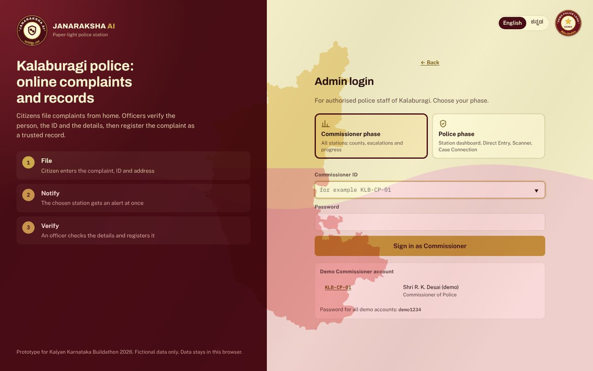

## Citizen portal

**Review step of the complaint form**: photo, masked ID, address and incident before submission.

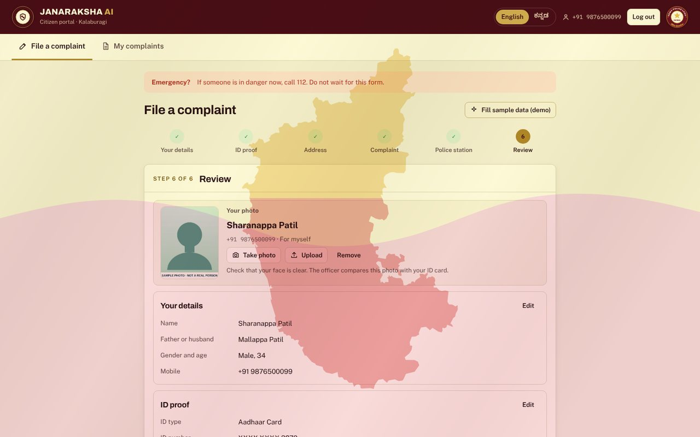

**Acknowledgment** with the complaint code, print and download.

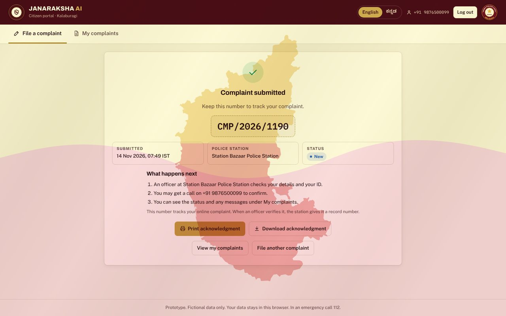

## Police phase

**Station dashboard**: counts for the officer's station, the four modules and complaints in progress.

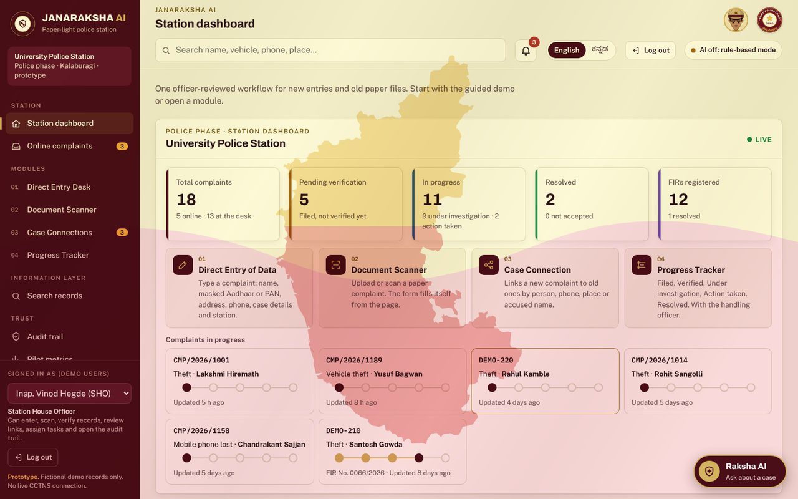

**Direct Entry of Data**: guided fields, masked Aadhaar, law sections and connected cases found while typing.

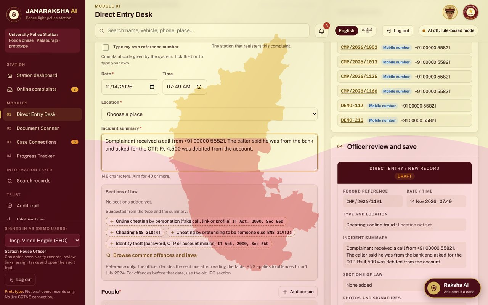

**Document Scanner**: a paper complaint with OCR text and the extracted fields with confidence.

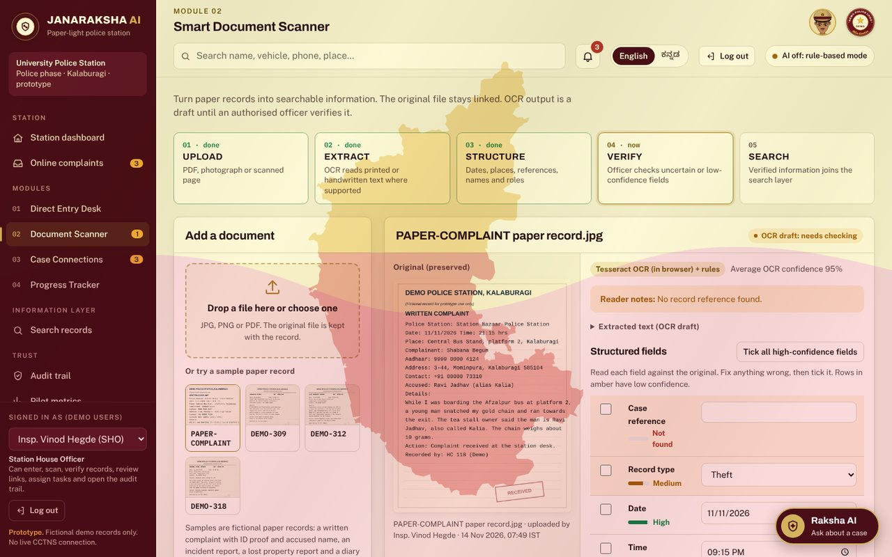

**Case Connection**: the scanned complaint linked to older cases by accused name, alias and place.

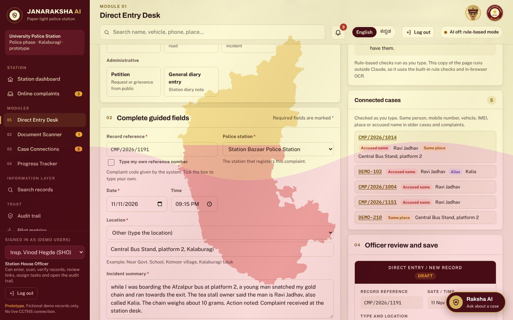

**Investigation progress**: stage, FIR number, handling officer and the progress-update form.

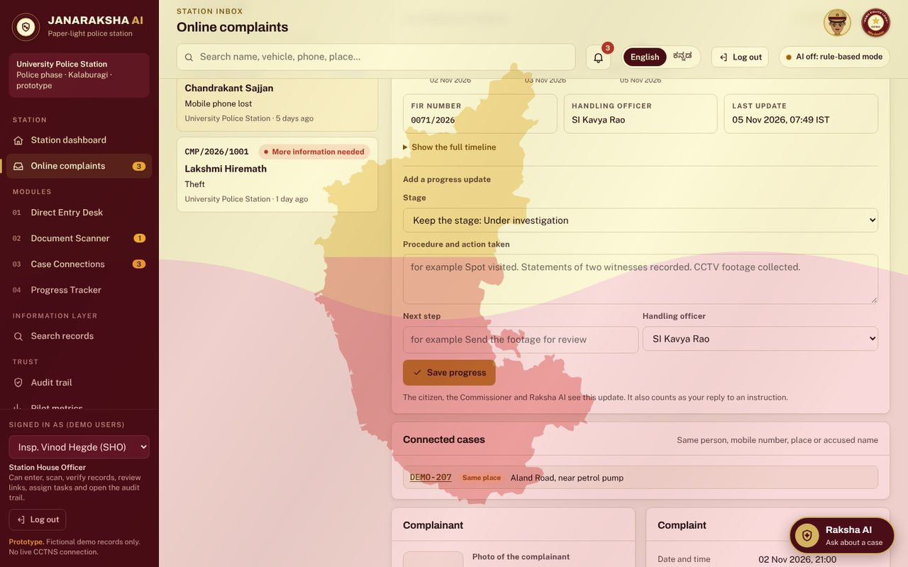

## Commissioner phase

**Commissioner dashboard**: counts, progress by stage and the online complaint escalation table.

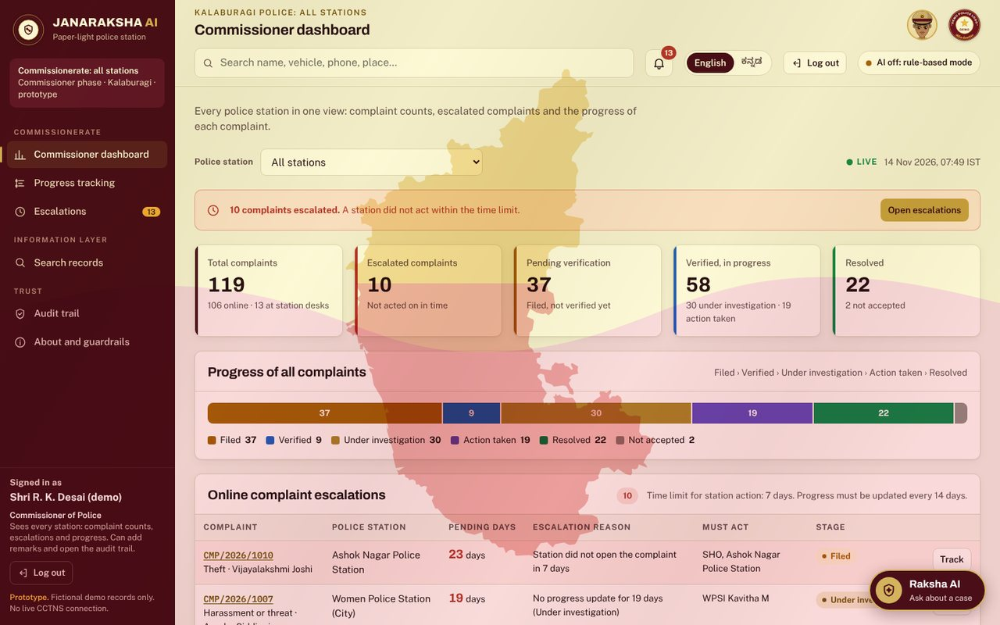

**Escalations**: pending days, reason, who must act, with instruction and reassignment actions.

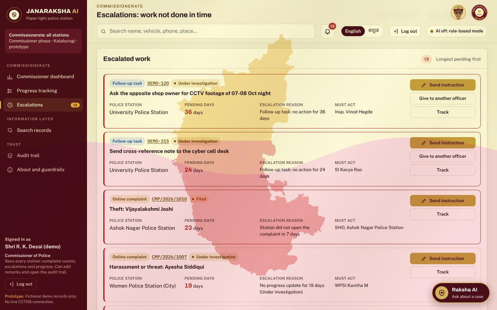

**Progress tracking**: every complaint with its stepper, and the detail view with timeline and remarks.

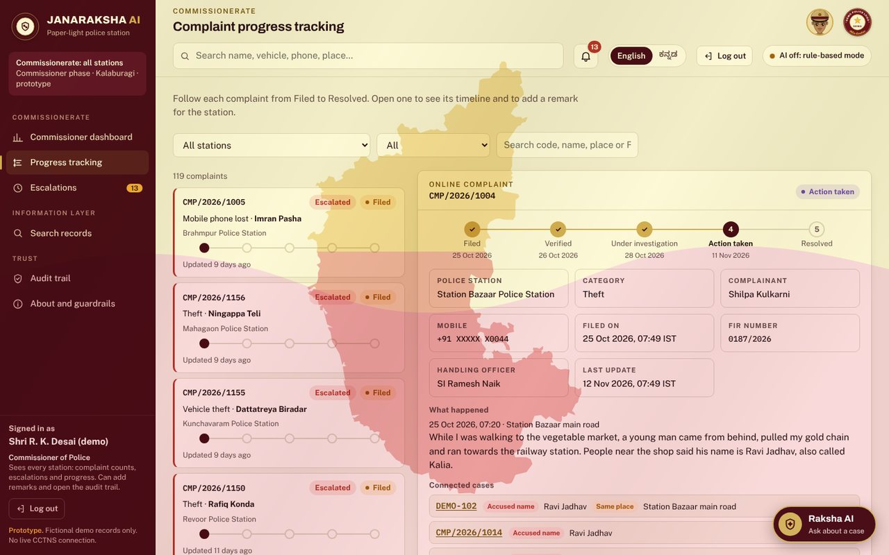

## Raksha AI

**Case card** for a complaint code: stage, FIR number, what happened, live timeline and next step.

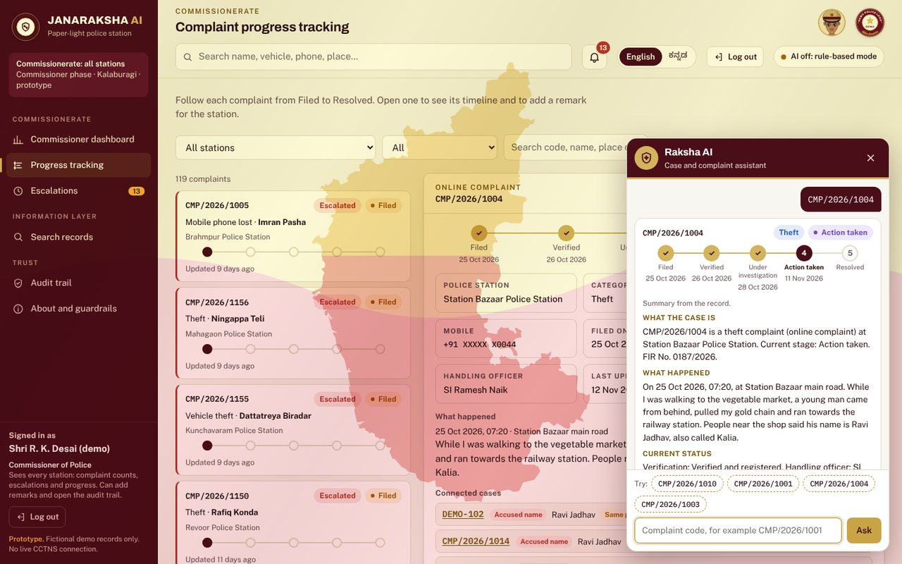

## Kannada and phone

**Kannada interface** (Commissioner dashboard).

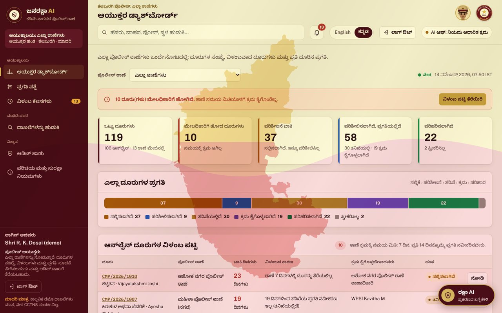

**Phone views**: dashboard counts, escalations and Raksha AI.

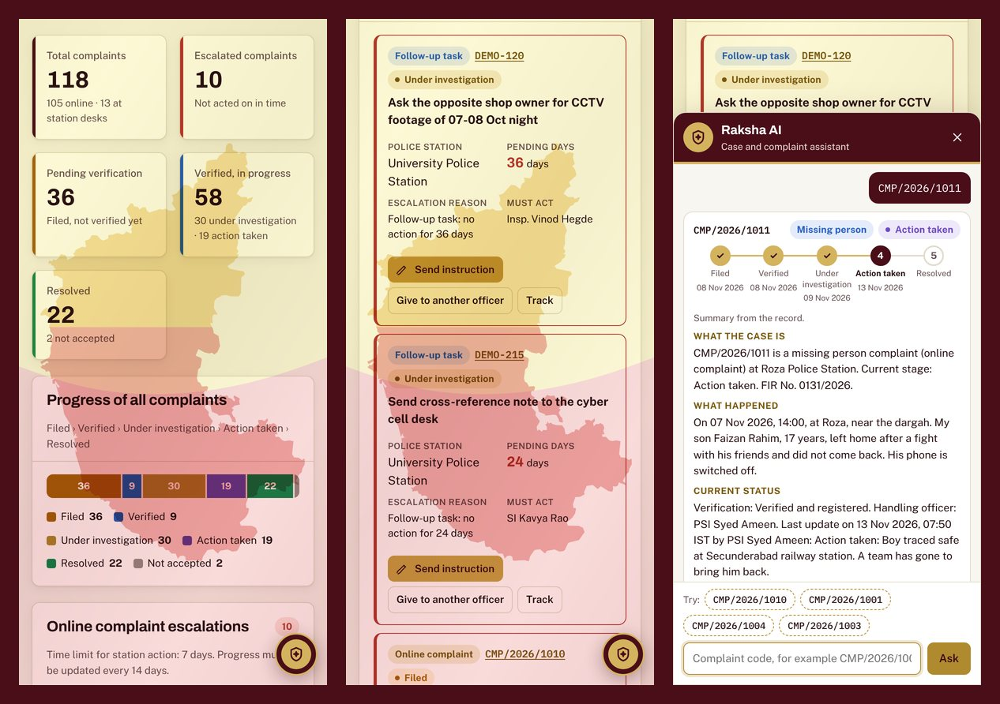
