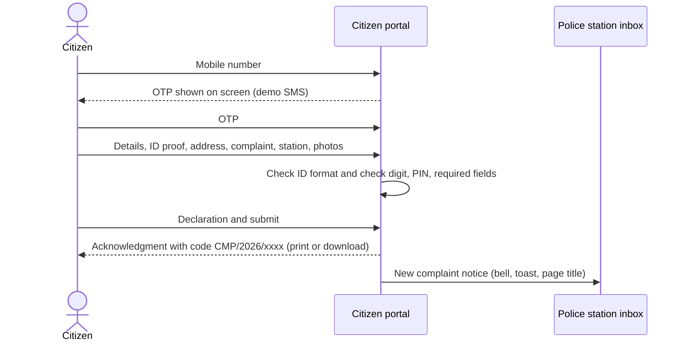
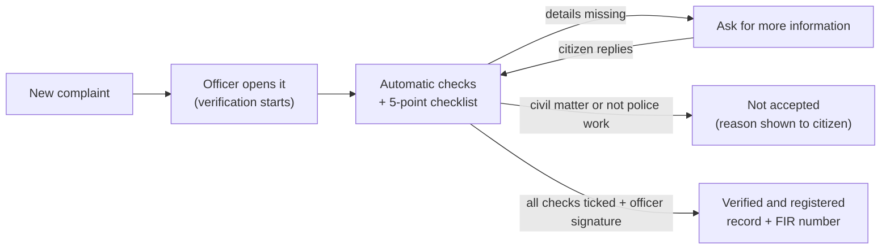
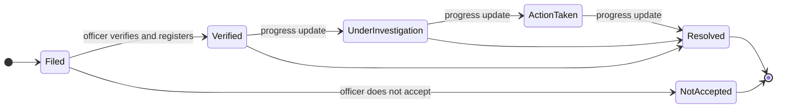
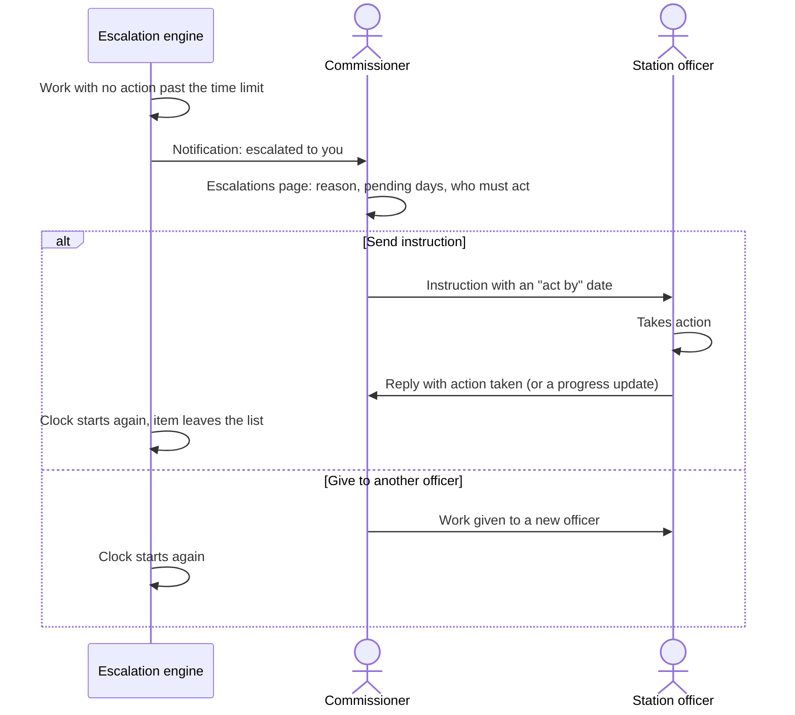
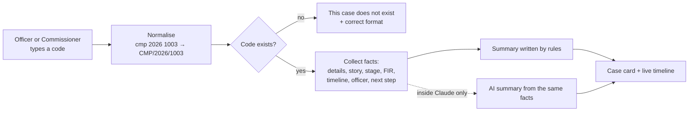

# User workflows

How each type of user moves through JanaRaksha AI. Every step here works in the prototype; the demo-only parts are marked.

## Contents

- [1. Citizen files a complaint](#1-citizen-files-a-complaint)
- [2. Station verifies and registers](#2-station-verifies-and-registers)
- [3. Investigation stages](#3-investigation-stages)
- [4. Paper complaint to structured record](#4-paper-complaint-to-structured-record)
- [5. Escalation to the Commissioner](#5-escalation-to-the-commissioner)
- [6. Raksha AI lookup](#6-raksha-ai-lookup)

## 1. Citizen files a complaint

1. The citizen chooses **Citizen** on the first page and enters a 10-digit mobile number.
2. The OTP appears on screen as a demo SMS (🟡 demo only).
3. The six-step form collects the details. ID numbers are checked and shown masked.
4. On **Review** the citizen checks everything, ticks the declaration and submits.
5. The acknowledgment shows the complaint code. It says clearly that it is not an FIR.
6. Later, **My complaints** shows the status, stage, FIR number, police questions and progress.

## 2. Station verifies and registers

- Only an **SI or SHO** can verify and register. A head constable or clerk can enter and update.
- Case types get the next **FIR number** of the station, for example `0071/2026`. Petitions and lost-property reports do not.
- The SI or SHO can reveal the full ID number to compare it with the card; the reveal is logged.

## 3. Investigation stages

Each progress update records **what was done**, the **next step**, the **handling officer** and the time. Only an SI or SHO can move the stage; other officers can add updates. The citizen, the Commissioner and Raksha AI all see the update.

## 4. Paper complaint to structured record

1. **Document Scanner › Add a document**: upload a photo or PDF, or use a sample paper record.
2. OCR reads the page (Tesseract.js in the browser, or Claude vision inside Claude).
3. The structuring step finds the reference, date, time, place, station, people, Aadhaar (masked at once), phone numbers, vehicles and the summary.
4. The officer checks the low-confidence fields and ticks them.
5. **Fill the Direct Entry form**: the officer completes the record, adds signatures and saves.
6. **Case Connection** shows older cases with the same person, phone, place or accused name.

## 5. Escalation to the Commissioner

| Work | Escalates after (default time limit 7 days) |
| --- | --- |
| Online complaint not opened by the station | 7 days |
| Online complaint opened but not verified | 7 days |
| Registered complaint with no progress update | 14 days |
| Station follow-up task with no action | 7 days |

- The Commissioner sets the time limit (3, 5, 6, 7 or 10 days) on the Escalations page.
- **Station officers never see escalations.** They see only the instruction, in the notifications, on the dashboard and on the task or complaint.
- The **demo clock** (🟡 demo only) moves time forward so that reviewers can see an escalation happen.

## 6. Raksha AI lookup

Raksha uses only the facts in the record. When AI writes the summary, the prompt forbids new facts, legal opinions and ID numbers, and the card still shows the facts below the summary so the officer can check them.
